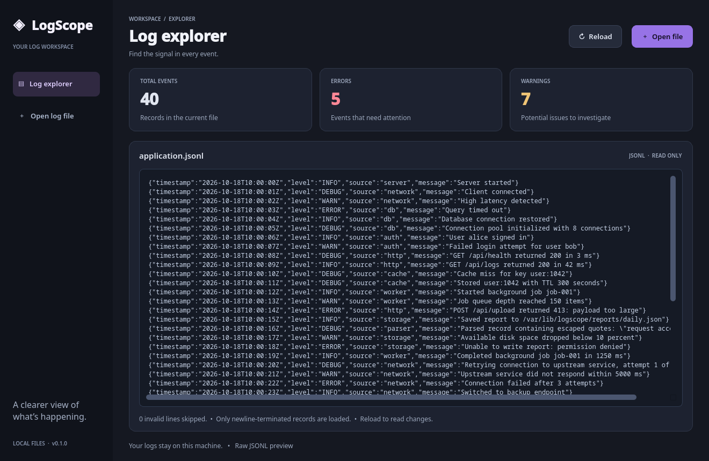

# LogScope

A lightweight Qt 6 desktop viewer for JSON Lines application logs, developed in C++20.

**Status:** early development, with a working desktop log explorer.

## Stack
- Fedora Linux, GCC, CMake, Ninja
- Qt 6 Widgets (installed from Fedora packages)
- Conan 2: fmt, spdlog, nlohmann_json
- GoogleTest for unit tests (provided by Conan)

## Build

```bash
sudo dnf install -y gcc-c++ cmake ninja-build qt6-qtbase-devel
conan profile detect   # once per machine, if no profile exists
conan install . -s build_type=Debug --build=missing
cmake --preset conan-debug
cmake --build build/Debug --parallel
ctest --test-dir build/Debug --output-on-failure
./build/Debug/logscope
```

Click **Open file** (Ctrl+O) to load `samples/application.jsonl`, or pass a file at launch:

```bash
./build/Debug/logscope samples/application.jsonl
```

The current UI previews raw JSONL and shows event, error, and warning counts. Click **Reload** to read file changes. Invalid lines are counted; incomplete final lines wait for a newline. Model/View tables, search, and severity filtering will be implemented in later steps.

Use the **Dark / Light** selector in the toolbar to switch appearance instantly. Your selection is remembered between launches. Themes live in `resources/themes/dark.qss` and `resources/themes/light.qss`. Edit either file and rebuild to customize it. CMake embeds both into the executable, so they work from any launch directory.



A graphical desktop or working SSH display forwarding is required to see the window.

Optional sample generator:
```bash
./build/Debug/logscope_samplegen samples/generated.jsonl
```

VS Code Remote SSH: use **CMake: Select Configure Preset → conan-debug**.
If Conan-generated files are missing, re-run `conan install ...` before CMake Configure.

## Roadmap
- [x] Project bootstrap, Conan dependencies and build
- [x] Basic JSONL parsing and raw file preview
- [ ] Model/View table display
- [ ] Search and severity filtering
- [ ] Follow appended file data without re-reading entire file
- [ ] Robust malformed-line reporting and tests
- [ ] Export filtered records
- [ ] Screenshots and release packaging

## License
MIT (see LICENSE). Third-party libraries retain their own licenses.
