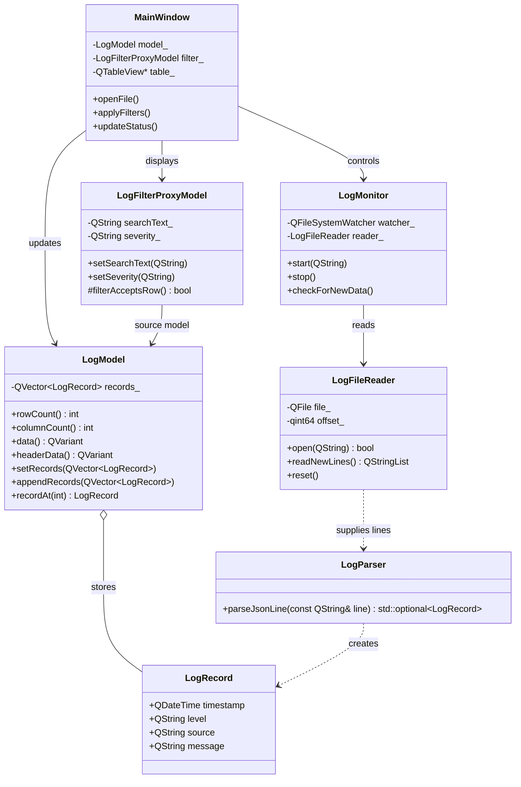

# Class diagram

Member names, types, visibility, and relationships follow the supplied class diagram. Signatures are design notation rather than complete C++ declarations.



## LogRecord and LogParser contract

`LogRecord` is a value type with a public `QDateTime timestamp` and three public `QString` fields. A default-constructed record has an invalid timestamp and empty strings; copying a record preserves its values.

Use this parser interface for the first implementation:

```cpp
std::optional<LogRecord> parseJsonLine(const QString& line) const;
```

`LogParser` has no parsing state and does not need to inherit from `QObject`.

- Accept one JSON object containing `timestamp`, `level`, `source`, and `message`, all strings.
- Return `std::nullopt` for malformed JSON, non-object JSON, missing required fields, or fields with non-string values.
- Convert the timestamp using `QDateTime::fromString(..., Qt::ISODate)`. Preserve the other string values, including Unicode, empty strings, whitespace, and decoded JSON escapes.
- Ignore additional fields. Accept surrounding JSON whitespace, including a trailing newline.
- For this first version, an unparseable timestamp produces an invalid `QDateTime` without rejecting the record. Severity values are unrestricted.
- Invalid input must not throw to the caller or affect subsequent calls.

`std::optional` is sufficient for success/failure initially. A future result type can include an error reason for the UI's parse-error reporting.

The tests in `tests/test_LogRecord.cpp` and `tests/test_LogParser.cpp` define this contract. They require the corresponding headers and parser implementation to be completed before they can compile and pass.
