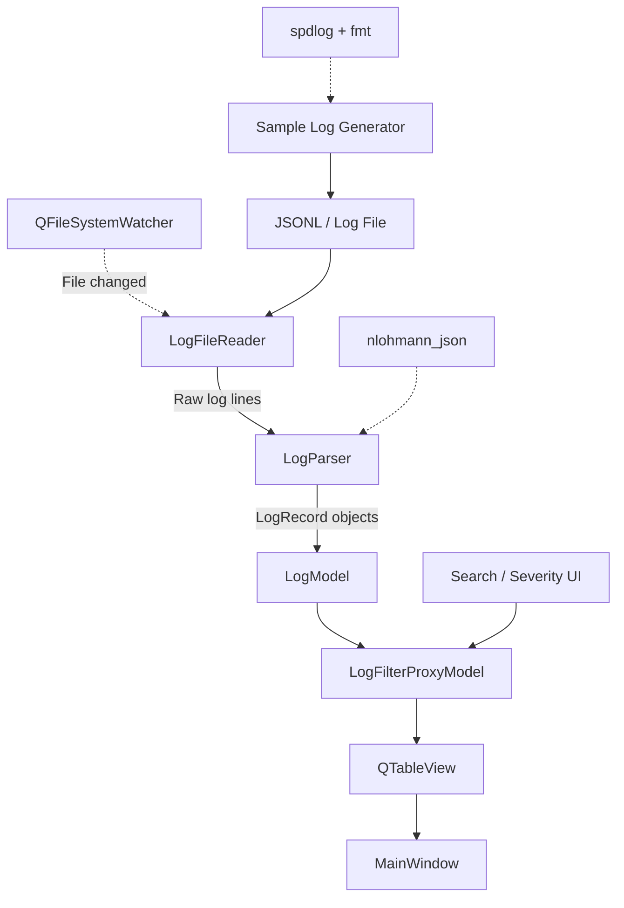

# High-level architecture

The arrows reproduce the supplied diagram's flow. `MainWindow` hosts the table and manages user interactions. The [class diagram](class-diagram.md) also introduces `LogMonitor` to coordinate file watching and reading.
