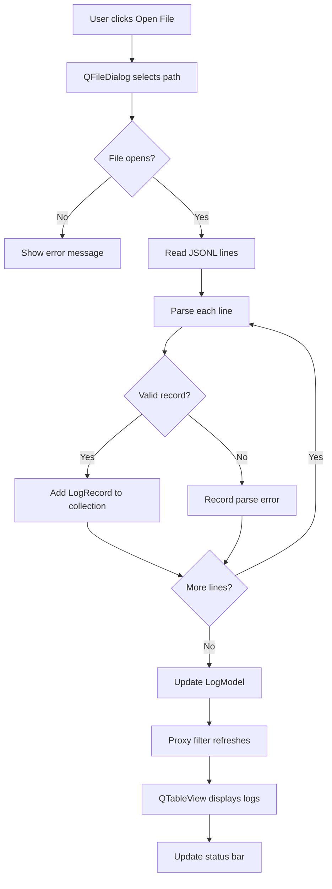

# Opening a log file

If a file cannot be opened, show an error. Otherwise, parse each line, collect valid records, and record parse errors while continuing through the remaining lines. Once all lines have been processed, update the model, refresh the filtered table, and update the status bar.
